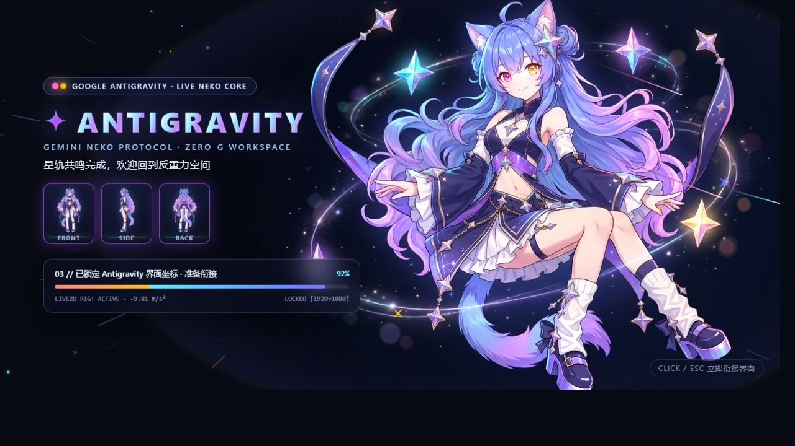
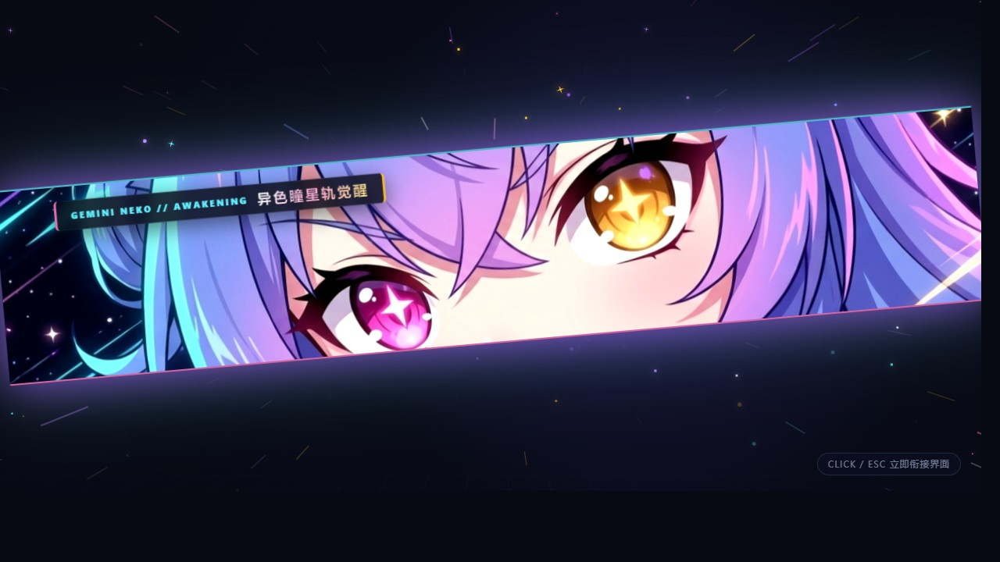

<div align="center">

# Antigravity × Gemini Catgirl Boot Animation

**为 Google Antigravity 打造的免 Hook、60fps Live2D 动态 Gemini 猫娘启动动画启动器**  
*Zero-hook, 60fps WebGL Live2D animated startup launcher with seamless Windows window handoff for Google Antigravity*


<br/>



<br/>



</div>

---

## 亮点特性 / Features

- **5 幕式二次元高燃开场（约 11 秒，随时可一键跳过）**：
  1. **Act 1 · 3D 跃迁星隧 & 星核爆发**：三维星轨加速隧道 + Gemini 四芒星双层青蓝/玫红冲击波；
  2. **Act 2 · 异色瞳觉醒 Cut-In 特写**：斜切霓虹特写带（Persona / 星铁风格）展示玫红 & 琥珀金双瞳四芒星高光；
  3. **Act 3 · 电光霓虹描线 → 彩虹星光唤醒**：像素级对齐的蓝紫霓虹线稿扫描，星光波扫过唤醒全彩形态；
  4. **Act 4 · 实时 WebGL Live2D 动态 Gemini 娘**：
     - 蓝紫长发零重力波浪飘动、蓬松猫尾摇摆、双猫耳与呆毛间歇轻抖；
     - 精确对准倾斜眼轴的**自然眨眼动画** + 异色瞳星芒脉冲；
     - 星月丝带飘拂、呼吸微动、流星与立体环绕四芒星、**鼠标 3D 景深视差**；
     - 左侧同步展示 `ANTIGRAVITY` 动态渐变字效、`FRONT / SIDE / BACK` 三视图扫描校准条及窗口探测进度；
     - 内置纯 Web Audio 合成的 10.5 秒星光竖琴与和弦开场音效（无需外部音频文件）。
  5. **Act 5 · 真实窗口锁定 & 无缝透明衔接**：
     - 后台静默拉起 `Antigravity.exe`（若 Antigravity 已在运行则跳过重复启动，绝不抢屏遮挡动画）；
     - 精准锁定真实 `Antigravity.exe` 主窗口坐标，随后以 Win32 分层窗口（`WS_EX_LAYERED`）60fps 平滑淡出，直接露出底层真实的 Antigravity 工作区并自动聚焦。
- **100% 免 Hook / 无侵入**：不修改 `Antigravity.exe` 或 `app.asar`，完全通过独立启动器运行，随时可卸载恢复。
- **随时跳过**：动画期间点击任意位置，或按 `Esc` / `Space` / `Enter` 立即切入主界面。

---

## 快速安装 / Quick Start (Windows 10/11)

### 环境要求
- Windows 10 / 11（自带 Edge WebView2 Runtime）
- Python 3.10+（勾选 Add to PATH）
- 已安装 [Google Antigravity](https://antigravity.google)

### 一键安装
1. 下载或克隆本仓库：
   ```bash
   git clone https://github.com/alexjulius2023/antigravity-gemini-boot.git
   cd antigravity-gemini-boot
   ```
2. 双击运行 **`Install.bat`**（自动安装 `pywebview` 并在桌面生成带定制猫耳图标的 **`Antigravity (Gemini 娘)`** 快捷方式）。
3. **开始使用**：
   - 双击桌面 **`Antigravity (Gemini 娘)`**：播放完整开场动画并无缝切入 Antigravity；
   - 双击 **`Preview_Animation.bat`**：随时单独预览动画（不重复启动 Antigravity）。

> 如希望直接替换桌面默认的 `Antigravity.lnk`（会自动备份原快捷方式），可运行：
> ```powershell
> powershell -ExecutionPolicy Bypass -File .\Install_Shortcut.ps1 -ReplaceDefault
> ```

---

## 自定义配置 / Configuration

编辑根目录下的 [`config.json`](config.json)：

| 配置项 | 默认值 | 说明 |
| :--- | :--- | :--- |
| `antigravity_exe` | `""` | 留空自动探测 `%LOCALAPPDATA%\Programs\Antigravity\Antigravity.exe`，也可手动填写绝对路径 |
| `fullscreen` | `true` | `true` 为无边框全屏无缝覆盖，`false` 为居中悬浮窗 |
| `sound_enabled` | `true` | 是否开启 Web Audio 星光开场音效 |
| `sound_volume` | `0.30` | 音效音量（`0.0` ~ `0.6`） |
| `min_duration_ms` | `10200` | 动画完整展示时长（毫秒），觉得太长或太短可直接调整 |
| `fade_out_ms` | `680` | 淡出衔接过渡时长（毫秒） |
| `subtitle` / `greeting` | 见配置 | 自定义左侧副标题与中文欢迎语 |

### 命令行参数 / CLI Flags
```bash
pythonw launcher.py               # 完整模式：播动画 + 启动/接管 Antigravity
pythonw launcher.py --preview     # 预览模式：仅播动画并淡出回当前窗口
pythonw launcher.py --windowed    # 1280×720 居中无边框窗口模式
pythonw launcher.py --mute        # 静音模式
```

---

## 项目结构 / Project Structure

```text
antigravity-gemini-boot/
├── launcher.py                   # Win32 进程启动、窗口锁定与 60fps 分层淡出衔接引擎
├── config.json                   # 用户可编辑配置
├── Install.bat                   # 一键安装依赖并创建桌面快捷方式
├── Install_Shortcut.ps1          # 桌面快捷方式生成器
├── Preview_Animation.bat         # 快速预览动画脚本
├── Launch_Antigravity_Gemini.vbs # 静默启动脚本备用封装
├── ui/
│   └── splash.html               # 5 幕动画 + 实时 WebGL Live2D 着色器 + Web Audio 合成音效
├── assets/                       # 主视觉立绘、Cut-In 特写、霓虹描线、三视图与 .ico 图标
├── scripts/
│   └── prepare_assets.py         # 霓虹描线图生成工具
└── docs/                         # README 预览截图
```

---

## 致谢与声明 / Credits & Disclaimer

- 本项目为开源社区非官方启动动画美化启动器，与 Google / Google DeepMind 无隶属关系。
- Gemini 娘（蓝紫长发、猫耳、异色瞳）角色设定灵感致敬原作者 **ZipZipPipe**。
- 本项目基于 [MIT License](LICENSE) 开源。
